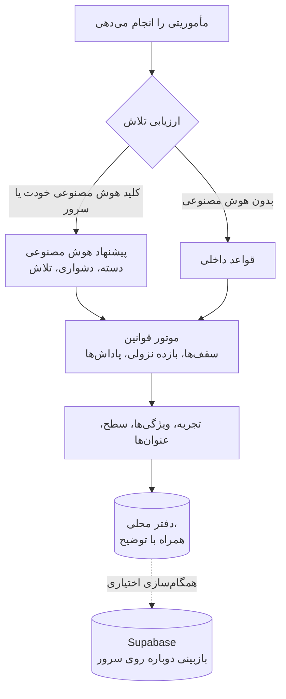

<div align="center">

<a href="https://wyrd-app.pages.dev">
  <picture>
    <source media="(prefers-color-scheme: dark)" srcset="docs/assets/banner-dark-fa.webp">
    <source media="(prefers-color-scheme: light)" srcset="docs/assets/banner-light-fa.webp">
    
  </picture>
</a>

[English](README.md) · **فارسی**

</div>

<div dir="rtl">

<div align="center">

<h3>تلاشِ واقعی‌ات را به شخصیتی تبدیل کن که رشد می‌کند.</h3>

مأموریت‌ها و عادت‌ها به تجربه، شش ویژگی و وقایع‌نامه‌ای زنده تبدیل می‌شوند.<br>
هوش مصنوعی پیشنهاد می‌دهد، قوانینِ شفاف تصمیم می‌گیرند و هر پاداش دلیلش را می‌گوید.

<br>

[](https://wyrd-app.pages.dev)
[](https://github.com/AliKahroodiEE/wyrd/releases/latest)
[](https://alikahroodiee.github.io/wyrd/)

[](https://github.com/AliKahroodiEE/wyrd/actions/workflows/ci.yml)
[](https://github.com/AliKahroodiEE/wyrd/actions/workflows/pages.yml)


-8B6CFF)
[](LICENSE.md)

[**دریافت**](#get-wyrd) · [**ویژگی‌ها**](#features) · [**تصاویر**](#screenshots) · [**شروع سریع**](#quick-start) · [**چطور کار می‌کند**](#how-it-works) · [**مستندات**](docs/) · [**مجوز**](#license)

</div>

<br>

> 💡 **همین حالا در [wyrd-app.pages.dev](https://wyrd-app.pages.dev) بازی کن:** یک حساب برای وب، اندروید و آیفون، با همگام‌سازی،
> انجمن‌ها و اعلان‌ها. فقط می‌خواهی نگاهی بیندازی؟ [نسخه‌ی نمایشی زنده](https://alikahroodiee.github.io/wyrd/) کاملاً در مرورگرت اجرا
> می‌شود و شش هفته سابقه‌ی نمونه دارد؛ هیچ داده‌ای از دستگاهت بیرون نمی‌رود.

## <a id="get-wyrd"></a>دریافت سرنوشت‌ساز

| کجا | چطور |
| --- | --- |
| **هر مرورگری** | **[wyrd-app.pages.dev](https://wyrd-app.pages.dev)** را باز کن. Chrome و Edge در نوار نشانی گزینه‌ی *Install* را نشان می‌دهند. |
| **آیفون و آیپد** | سایت را در Safari باز کن، **Share** و بعد **Add to Home Screen** را بزن. اعلان‌ها در برنامه‌ی صفحه‌ی اصلی کار می‌کنند (iOS 16.4 به بعد). |
| **اندروید** | فایل APK را از **[Releases](https://github.com/AliKahroodiEE/wyrd/releases/latest)** بگیر، یا این مخزن را به [Obtainium](https://obtainium.imranr.dev) اضافه کن تا به‌روزرسانی‌ها خودکار برسند. |

یک حساب همه‌جا کار می‌کند: با کدی که ایمیل می‌شود، رمز عبور، گوگل یا گیت‌هاب وارد شو تا شخصیتت با تو از دستگاهی
به دستگاه دیگر بیاید. بدون حساب هم می‌شود بازی کرد؛ آن‌وقت داده‌ها روی همان دستگاه می‌مانند.

## <a id="why"></a>چرا سرنوشت‌ساز

بیشتر برنامه‌های عادت‌سازی برای تیک‌زدن یک خانه امتیاز می‌دهند. سرنوشت‌ساز می‌پرسد واقعاً چه کردی و از
همان، شخصیتی ماندگار می‌سازد: مطالعه هوش را بالا می‌برد، تمرین قدرت را می‌سازد و پای قولی ماندن که
از قبل برایش برنامه ریخته بودی، انضباط را آب‌دیده می‌کند. هوش مصنوعی تلاشت را می‌خواند؛ یک موتورِ
قطعی برایش سقف می‌گذارد، بازده نزولی را اعمال می‌کند، نتیجه را در دفتری قابل‌حسابرسی ثبت می‌کند و
دقیقاً می‌گوید چرا رشد کردی.

نه سازوکارِ شرمساری، نه حلقه‌ی قمار، نه ترس از شکستنِ زنجیره. ویژگی‌ها وقتی استراحت می‌کنی هرگز افت
نمی‌کنند، برای امتحان و بیماری «حالت توقف» هست و چالش‌های انجمن هیچ‌وقت یک گروه را به خاطر روزِ
بدِ یک نفر جریمه نمی‌کنند. این طراحی بر پایه‌ی پژوهش‌های منتشرشده درباره‌ی انگیزه و شکل‌گیری عادت
است ([`docs/research`](docs/research/behavioral-science.md)).

## <a id="features"></a>ویژگی‌ها

<table>
  <tr>
    <td width="33%" valign="top">
      <p><b>⚔️ مأموریت‌هایی به اندازه‌ی زندگی واقعی</b></p>
      مأموریت‌های روزانه، قراردادها و اهداف بلندمدت؛ با تکرار، زیرکار، زمان‌سنج، یادآور و نیتِ
      «کِی و کجا».
    </td>
    <td width="33%" valign="top">
      <p><b>🧬 شش ویژگی، تجربه‌ی صادقانه</b></p>
      قدرت، هوش، انضباط، خلاقیت، سرزندگی و ارتباط. سطح، عنوان‌ها و کلاس از کاری که انجام می‌دهی
      شکل می‌گیرند، نه از چیزی که ادعا می‌کنی.
    </td>
    <td width="33%" valign="top">
      <p><b>⚖️ هوش مصنوعی پیشنهاد می‌دهد، قوانین تصمیم می‌گیرند</b></p>
      موتور قوانین دو بار نوشته شده، در Dart و TypeScript، و بردارهای آزمونِ مشترک آن دو را به هم
      گره می‌زنند؛ پس گوشی و سرور سرِ هر امتیاز هم‌نظرند.
    </td>
  </tr>
  <tr>
    <td valign="top">
      <p><b>🔑 هوش مصنوعی خودت</b></p>
      Anthropic، OpenAI، Google Gemini یا هر سرویس سازگار مثل OpenRouter، Groq و Ollama. کلیدت فقط در
      حافظه‌ی امنِ دستگاهت می‌ماند. هوش مصنوعی نداری؟ قواعدِ داخلی همه‌چیز را ارزیابی می‌کنند.
    </td>
    <td valign="top">
      <p><b>🛡️ انجمن‌ها</b></p>
      انجمن‌های خصوصی با تالار، واکنش، نظر و چالش‌های گروهی؛ ساخته‌شده برای دلگرمی، نه مقایسه.
    </td>
    <td valign="top">
      <p><b>📜 وقایع‌نامه‌ای که خودش نوشته می‌شود</b></p>
      تحلیل هفتگی، ماهانه و سالانه، نمای ریتم و توازن، دفتر کاملِ پاداش‌ها و خلاصه‌هایی از هوش مصنوعی
      که بر داده‌های واقعی‌ات تکیه دارند.
    </td>
  </tr>
  <tr>
    <td valign="top">
      <p><b>🌗 روشن و تیره</b></p>
      تیره مثل سنگ و اخگر، روشن مثل پوست‌نوشته و جوهر. از دستگاهت پیروی می‌کند، یا با یک ضربه از
      برگه‌ی شخصیت عوضش کن.
    </td>
    <td valign="top">
      <p><b>🌍 فارسی و English</b></p>
      به زبان دستگاهت باز می‌شود. چیدمانِ کاملِ راست‌به‌چپ، تقویم جلالی، ارقام فارسی و متن‌های
      دوزبانه‌ای که همیشه درست خوانده می‌شوند.
    </td>
    <td valign="top">
      <p><b>📶 اول روی دستگاه</b></p>
      در حالت مهمان همه‌چیز روی خودِ دستگاه کار می‌کند، حتی آفلاین. حساب کاربری، همگام‌سازی و انجمن‌ها
      اختیاری‌اند.
    </td>
  </tr>
</table>

## <a id="screenshots"></a>تصاویر

<p align="center"><sub>این تصاویر با پوسته‌ای که در GitHub انتخاب کرده‌ای هماهنگ‌اند: بین روشن و تیره جابه‌جا شو تا روی دیگرش را ببینی.</sub></p>

<table>
  <tr>
    <td align="center" width="25%">
      <picture>
        <source media="(prefers-color-scheme: light)" srcset="docs/screenshots/phone-character-light-fa.webp">
        
      </picture>
      <br><sub><b>برگه‌ی شخصیت</b><br>سطح، وضعیت و مأموریت‌های امروز</sub>
    </td>
    <td align="center" width="25%">
      <picture>
        <source media="(prefers-color-scheme: light)" srcset="docs/screenshots/phone-reward-light-fa.webp">
        
      </picture>
      <br><sub><b>پاداش‌هایی که خودشان را توضیح می‌دهند</b><br>هر امتیاز دلیلی دارد</sub>
    </td>
    <td align="center" width="25%">
      <picture>
        <source media="(prefers-color-scheme: light)" srcset="docs/screenshots/phone-quests-light-fa.webp">
        
      </picture>
      <br><sub><b>مأموریت‌ها و عادت‌ها</b><br>روزانه، قرارداد، هدف بلندمدت</sub>
    </td>
    <td align="center" width="25%">
      <picture>
        <source media="(prefers-color-scheme: light)" srcset="docs/screenshots/phone-chronicle-light-fa.webp">
        
      </picture>
      <br><sub><b>وقایع‌نامه</b><br>با تقویم جلالی</sub>
    </td>
  </tr>
</table>

<picture>
  <source media="(prefers-color-scheme: light)" srcset="docs/screenshots/desktop-character-light-fa.webp">
  
</picture>

<details>
<summary><b>تصاویر بیشتر</b>: هر دو پوسته کنار هم، وقایع‌نامه در دسکتاپ، تنظیمات</summary>
<br>


<picture>
  <source media="(prefers-color-scheme: light)" srcset="docs/screenshots/desktop-chronicle-light-fa.webp">
  
</picture>

<table>
  <tr>
    <td align="center" width="33%">
      <picture>
        <source media="(prefers-color-scheme: light)" srcset="docs/screenshots/phone-settings-light-fa.webp">
        
      </picture>
      <br><sub>زبان و پوسته روی «خودکار»</sub>
    </td>
    <td align="center" width="33%">
      
      <br><sub>انگلیسی، روشن</sub>
    </td>
    <td align="center" width="33%">
      
      <br><sub>انگلیسی، تیره</sub>
    </td>
  </tr>
</table>

</details>

<sub>همه‌ی تصاویر از خودِ برنامه با قلم‌های واقعی‌اش و شش هفته داده‌ی نمونه ساخته شده‌اند. بخش
<a href="#regenerating-screenshots">بازسازی تصاویر</a> را ببین.</sub>

## <a id="quick-start"></a>شروع سریع

به Flutter پایدار نسخه‌ی ۳٫۴۷ یا بالاتر و Dart نسخه‌ی ۳٫۱۳ یا بالاتر نیاز داری.

<div dir="ltr">

```bash
git clone https://github.com/AliKahroodiEE/wyrd.git
cd wyrd/app
flutter pub get
# Six weeks of sample history; drop the flag for a fresh start
flutter run -d chrome --dart-define=WYRD_DEMO=true
```

</div>

برای اجرا روی گوشی اندروید یا شبیه‌ساز iOS، در فرمان بالا به‌جای `chrome` شناسه‌ی دستگاه را بنویس؛ فرمان
`flutter devices` فهرستشان را نشان می‌دهد. بدون پیکربندی سرور،
سرنوشت‌ساز کاملاً روی خودِ دستگاه اجرا می‌شود: همه‌ی امکانات به جز حساب کاربری، همگام‌سازی و انجمن‌ها
آفلاین کار می‌کنند.

<details>
<summary><b>نسخه‌ی نمایشی فارسی، اتصال به سرور و گزینه‌های دیگر</b></summary>
<br>

<div dir="ltr">

```bash
# Seed the demo in Persian regardless of the device language
flutter run -d chrome --dart-define=WYRD_DEMO=true --dart-define=WYRD_DEMO_LOCALE=fa

# Connect a Supabase backend (accounts, sync, guilds, push)
flutter run --dart-define=SUPABASE_URL=https://<project>.supabase.co \
            --dart-define=SUPABASE_PUBLISHABLE_KEY=<publishable-key>
```

</div>

راه‌اندازی سرور در [`backend/README.md`](backend/README.md) توضیح داده شده است.

</details>

## <a id="how-it-works"></a>چطور کار می‌کند



- **هوش مصنوعی هرگز مستقیم به شخصیتت دست نمی‌زند.** فقط یک پیشنهادِ ساختاریافته برمی‌گرداند. موتور
  آن را محدود می‌کند و روی سرور، پیشنهادِ هوش مصنوعیِ خودت باید در فاصله‌ی یک پله دشواری و حداکثر دو
  برابرِ مدت‌زمانِ تخمینِ خودِ سرور بماند.
- **موتور خالص و نسخه‌دار است.** همان قوانین در Dart روی دستگاه و در TypeScript روی سرور اجرا می‌شوند و
  بردارهای آزمونِ مشترک آن‌ها را هم‌گام نگه می‌دارند
  ([ADR-004](docs/architecture/adr/004-dual-engine-conformance.md)).
- **اول روی دستگاه.** هر تغییر اول در پایگاه‌داده‌ی محلیِ SQLite ثبت می‌شود، که در وب روی WebAssembly اجرا می‌شود، و بعد
  از راه یک صفِ خروجی با ساعت‌های منطقیِ ترکیبی همگام می‌شود
  ([ADR-003](docs/architecture/adr/003-local-first-sync.md)).

<details>
<summary><b>فناوری‌ها</b></summary>
<br>

| لایه | ساخته‌شده با |
| --- | --- |
| برنامه | Flutter · Riverpod 3 · go_router · Drift با SQLite، که در وب روی WebAssembly اجرا می‌شود · fl_chart |
| موتور قوانین | بسته‌ی خالصِ Dart، با همزادی در TypeScript که بردارهای آزمونِ مشترک به هم گره‌شان می‌زنند |
| سرور | Supabase: پستگرس با امنیت در سطح سطر، RPCها، Edge Functions (Deno)، pg_cron |
| هوش مصنوعی | Anthropic Messages، OpenAI Chat Completions، Google Gemini؛ همه مستقیم از خودِ دستگاه |
| بومی‌سازی | کاتالوگ‌های ARB با gen-l10n · فارسی و انگلیسی · تقویم جلالی با `shamsi_date` |
| CI/CD | GitHub Actions: تحلیل، قالب‌بندی و همه‌ی آزمون‌ها؛ استقرار وب روی Cloudflare Pages، سرور روی Supabase و APKهای امضاشده در GitHub Releases؛ پشتیبان رمزنگاری‌شده‌ی روزانه؛ نسخه‌ی نمایشی روی GitHub Pages |

</details>

## <a id="status"></a>وضعیت پروژه

| بخش | وضعیت |
| --- | --- |
| پژوهش، مشخصات محصول، قوانین پیشرفت، سیستم طراحی، تجربه‌ی کاربری، معماری و ADRها | ✅ [`docs`](docs/) |
| موتور قوانین در Dart با ۱۰۳ آزمون و در TypeScript با ۴۶ آزمون، گره‌خورده با بردارهای انطباق | ✅ [`packages`](packages/) |
| برنامه‌ی اول‌روی‌دستگاه: برگه‌ی شخصیت، مأموریت‌ها، پاداش‌ها، دفتر، وقایع‌نامه، تنظیمات، آشنایی | ✅ [`app`](app/) |
| پوسته‌های روشن و تیره با کلید یک‌ضربه‌ای؛ زبان و پوسته از دستگاه پیروی می‌کنند | ✅ |
| فارسی و انگلیسی، راست‌به‌چپ کامل، تقویم جلالی و میلادی، ارقام فارسی یا لاتین | ✅ |
| چیدمان‌های تطبیقی: گوشی (نوار شناور)، تبلت (ریل)، دسکتاپ و وب (نوار کناری، ستون‌ها) | ✅ |
| سرور: طرح‌واره، امنیت در سطح سطر، RPCهای همگام‌سازی و پیشرفت، توابع هوش مصنوعی، اعلان | ✅ [`backend`](backend/) |
| حساب کاربری، همگام‌سازی، ارزیابی روی سرور، انجمن‌ها (تالار، واکنش، نظر، چالش) | ✅ |
| هوش مصنوعی خودت: Anthropic، OpenAI، Gemini و سرویس‌های سازگار | ✅ |
| ورود با کد ایمیلی، رمز عبور، گوگل یا گیت‌هاب | ✅ |
| محیط عملیاتی با پلن‌های رایگان: وب روی Cloudflare Pages، سرور روی Supabase، APK امضاشده در GitHub Releases، برنامه‌ی صفحه‌ی اصلی آیفون | ✅ [`docs/deployment.fa.md`](docs/deployment.fa.md) |

<details>
<summary><b>چه چیزهایی آزموده شده و چه چیزهایی نه</b></summary>
<br>

**آزموده شده:** همه‌ی آزمون‌های موتور، برنامه و سرور؛ تحلیل ایستا؛ همه‌ی مهاجرت‌ها و ۱۱۷ بررسی امنیتی و
رفتاری روی PGlite، یک پستگرسِ آفلاین؛ بررسی نوعِ همه‌ی Edge Functionها؛ اجرای نسخه‌ی وب در مرورگر به
فارسی و انگلیسی، در روشن و تیره، در عرض گوشی، تبلت و دسکتاپ.

**هنوز آزموده نشده:** نخستین استقرار عملیاتی (پروژه‌ی زنده‌ی Supabase، ایمیل واقعی، ورود با گوگل و گیت‌هاب،
فراخوانی هوش مصنوعی و اعلان) و برنامه‌های بومی روی دستگاه واقعی. CI با هر تگ انتشار، APK امضاشده‌ی اندروید
را می‌سازد؛ iOS از برنامه‌ی وبِ صفحه‌ی اصلی استفاده می‌کند. متن فارسی پیش از
انتشار باید به دست یک ویراستارِ فارسی‌زبان بازبینی شود.

</details>

### نقشه‌ی راه

- [x] **پایه**: موتور قوانین، برنامه‌ی اول‌روی‌دستگاه، مأموریت‌ها، برگه‌ی شخصیت، فارسی و انگلیسی
- [x] **متصل**: حساب کاربری، همگام‌سازی، ارزیابی روی سرور، اعلان‌ها
- [x] **اجتماعی**: انجمن‌های خصوصی با تالار، واکنش، نظر و چالش
- [x] **وقایع‌نامه**: تحلیل هفتگی، ماهانه و سالانه، وقایع‌نامه‌هایی به قلم هوش مصنوعی
- [x] **عملیاتی**: میزبانی رایگان برای وب، سرور و اندروید؛ ورود با گوگل و گیت‌هاب؛ اعلان روی همه‌ی سکوها
- [ ] **موتور انگیزه**: گزارش صبحگاهی، بازتاب شبانه، مرور هفتگی
- [ ] **عمومی**: انجمن‌های عمومی و نظارت، نسخه‌ی ویژه و آرایه‌ها
- [ ] **فروشگاه‌ها**: Google Play و App Store

## <a id="hosting"></a>میزبانی

| چه می‌خواهی | چه چیزی را میزبانی می‌کنی |
| --- | --- |
| برنامه روی گوشی، همه‌چیز محلی | هیچ |
| نسخه‌ی وب، در مرورگرهای دسکتاپ و موبایل | فقط فایل‌های ایستا: `flutter build web` روی GitHub Pages، Cloudflare Pages، Netlify یا Vercel. این مخزن با هر push به `main` [نسخه‌ی نمایشی](.github/workflows/pages.yml) را روی GitHub Pages منتشر می‌کند، و اگر برنامه تغییر کرده باشد [نسخه‌ی عملیاتی](.github/workflows/deploy-web.yml) را روی Cloudflare Pages. |
| حساب کاربری، همگام‌سازی بین دستگاه‌ها، انجمن‌ها و اعلان | سرورِ Supabase در [`backend`](backend/)، روی Supabase Cloud یا میزبانی شخصی، که [`deploy-backend.yml`](.github/workflows/deploy-backend.yml) منتشرش می‌کند |

**نسخه‌ی خودت را رایگان راه بینداز.** [`docs/deployment.fa.md`](docs/deployment.fa.md) همه‌ی مرحله‌ها را با پلن‌های
رایگان و بدون نیاز به هیچ کارت بانکی توضیح می‌دهد.

**هوش مصنوعی اختیاری است و می‌تواند هیچ هزینه‌ای برای گرداننده نداشته باشد.** هر کاربر می‌تواند حساب
Anthropic، OpenAI، Google Gemini یا سرویس سازگارِ خودش را در *تنظیمات ← هوش مصنوعی ← هوش مصنوعی خودت*
وصل کند. کلید در حافظه‌ی امنِ دستگاه می‌ماند و فقط به همان سرویس فرستاده می‌شود. کلیدِ سمتِ سرور با نام
`ANTHROPIC_API_KEY` هم پشتیبانی می‌شود، اما الزامی نیست.

## <a id="development"></a>توسعه

<div dir="ltr">

```text
.
├── app/            Flutter client (Android, iOS, Web)
├── packages/       Shared pure-Dart packages (the rules engine)
├── backend/        Supabase schema, row-level security, Edge Functions
├── tool/           Repository scripts (README image conversion)
└── docs/           Research, product spec, design system, architecture, ADRs
```

```bash
cd packages/wyrd_engine && dart test   # rules engine
cd app && flutter test                 # data, l10n, RTL lint, widgets
cd app && flutter analyze --fatal-infos
```

</div>

CI همه‌ی این‌ها را به‌علاوه‌ی ساخت وب با هر push اجرا می‌کند ([`ci.yml`](.github/workflows/ci.yml)).

### <a id="regenerating-screenshots"></a>بازسازی تصاویر

همه‌ی تصاویرِ این صفحه از آزمون‌های ویجتی ساخته می‌شوند که خودِ برنامه را با داده‌ی نمونه، در هر دو
پوسته و هر دو زبان اجرا می‌کنند و بعد قاب می‌گیرند. یک اسکریپت کوچک خروجی‌ها را به WebP تبدیل می‌کند
که به Python 3 و Pillow نیاز دارد:

<div dir="ltr">

```bash
./tool/readme_images.sh
```

</div>

### <a id="localization"></a>بومی‌سازی

فارسی و انگلیسی هر دو زبانِ درجه‌یک‌اند. همه‌ی متن‌ها در کاتالوگ‌های ARB با کلیدهای ثابت نگه داشته
می‌شوند، چیدمان‌ها به‌جای چپ و راست از «آغاز» و «پایان» استفاده می‌کنند و برنامه تا وقتی کاربر زبانی
انتخاب نکرده، از زبان دستگاه پیروی می‌کند. افزودن یک زبان تازه کاری محتوایی است، نه مهندسی؛
[`docs/localization.md`](docs/localization.md) را ببین. این صفحه [به انگلیسی](README.md) هم هست.

## <a id="license"></a>مجوز

**منبع‌دسترس است، نه متن‌باز به معنای OSI.** این کد منتشر شده تا بتوانی آن را بخوانی، از آن یاد بگیری و
ارزیابی‌اش کنی، تحت [مجوز PolyForm Strict 1.0.0](LICENSE.md). به زبان ساده:

- ✅ می‌توانی کد را بخوانی و برای مطالعه یا آزمایشِ شخصی و غیرتجاری اجرا کنی.
- ❌ **نمی‌توانی** آن را، چه کامل و چه بخشی از آن، دوباره منتشر کنی.
- ❌ **نمی‌توانی** آن را تغییر دهی یا اثر تازه‌ای بر پایه‌اش بسازی.
- ❌ **نمی‌توانی** از آن برای هیچ هدفِ تجاری استفاده کنی.

برای هر کاربرد دیگر (مجوز تجاری، همکاری، یا اجازه‌ی استفاده‌ی دوباره از بخشی از کد) از طریق GitHub با
نویسنده تماس بگیر. متنِ الزام‌آور، [`LICENSE.md`](LICENSE.md) به زبان انگلیسی است؛ این خلاصه و این
ترجمه مشاوره‌ی حقوقی نیستند.

## <a id="contributing"></a>مشارکت

چون مجوز اجازه‌ی ساختِ آثارِ مشتق را نمی‌دهد، درخواست‌های ادغام بدون یک توافق‌نامه‌ی
کتبیِ جداگانه پذیرفته نمی‌شوند. گزارش اشکال و ایده‌ها در قالب
[issue](https://github.com/AliKahroodiEE/wyrd/issues) با آغوش باز پذیرفته می‌شوند؛
[`CONTRIBUTING.md`](CONTRIBUTING.md) را ببین.

<br>

<div align="center">

**اگر سرنوشت‌ساز جرقه‌ای در ذهنت زد، یک ⭐ کمک می‌کند دیگران هم پیدایش کنند.**

<sub>حق نشر © ۲۰۲۶ AliKahroodiEE. همه‌ی حقوقی که صراحتاً واگذار نشده، محفوظ است.</sub>

</div>

</div>
