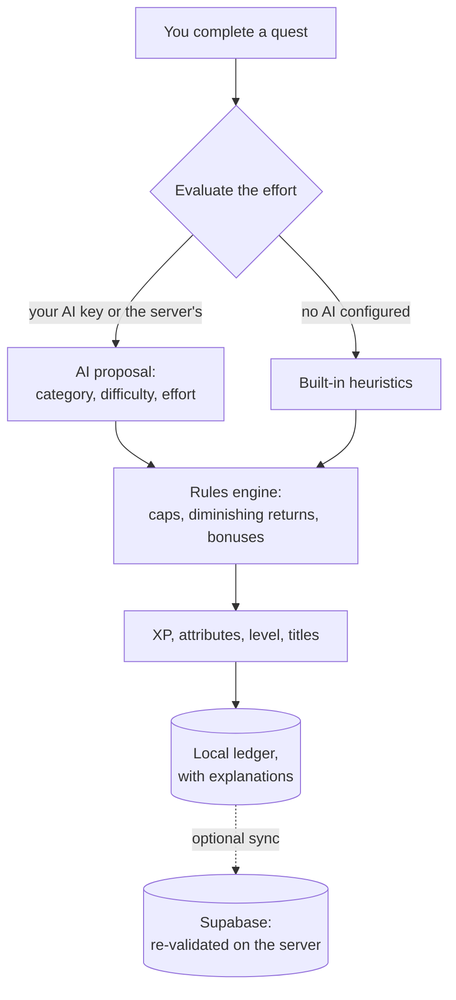

<div align="center">

<a href="https://wyrd-app.pages.dev">
  <picture>
    <source media="(prefers-color-scheme: dark)" srcset="docs/assets/banner-dark-en.webp">
    <source media="(prefers-color-scheme: light)" srcset="docs/assets/banner-light-en.webp">
    
  </picture>
</a>

**English** · [فارسی](README.fa.md)

<h3>Turn real effort into a character that grows.</h3>

Quests and habits become XP, six attributes and a living chronicle.<br>
AI proposes, honest rules decide, and every reward explains itself.

<br>

[](https://wyrd-app.pages.dev)
[](https://github.com/AliKahroodiEE/wyrd/releases/latest)
[](https://alikahroodiee.github.io/wyrd/)

[](https://github.com/AliKahroodiEE/wyrd/actions/workflows/ci.yml)
[](https://github.com/AliKahroodiEE/wyrd/actions/workflows/pages.yml)


-8B6CFF)
[](LICENSE.md)

[**Get Wyrd**](#get-wyrd) · [**Features**](#features) · [**Screenshots**](#screenshots) · [**Quick start**](#quick-start) · [**How it works**](#how-it-works) · [**Docs**](docs/) · [**License**](#license)

</div>

<br>

> [!TIP]
> **Play now at [wyrd-app.pages.dev](https://wyrd-app.pages.dev):** one account on the web, Android and iPhone, with sync, guilds and
> push notifications. Just looking? The [live demo](https://alikahroodiee.github.io/wyrd/) runs entirely in your browser with six weeks
> of sample history, and nothing leaves your device.

## Get Wyrd

| On | How |
| --- | --- |
| **Any browser** | Open **[wyrd-app.pages.dev](https://wyrd-app.pages.dev)**. Chrome and Edge offer *Install* in the address bar. |
| **iPhone and iPad** | Open the site in Safari, tap **Share**, then **Add to Home Screen**. Notifications work in the Home Screen app (iOS 16.4+). |
| **Android** | Download the APK from **[Releases](https://github.com/AliKahroodiEE/wyrd/releases/latest)**, or add this repository to [Obtainium](https://obtainium.imranr.dev) for automatic updates. |

One account works everywhere: sign in with an emailed code, a password, Google or GitHub, and your character follows
you between devices. Guests can play without an account; their data stays on the device.

## Why Wyrd

Most habit apps hand out points for ticking a box. Wyrd asks what you actually did, then grows a
persistent character from it: study raises Intelligence, training builds Strength, keeping a
promise you planned forges Discipline. An AI reads the effort; a deterministic engine caps it,
applies diminishing returns, writes it to an auditable ledger and tells you exactly why you grew.

No shame mechanics, no gambling loops, no streak terror. Attributes never decay while you rest,
pause mode exists for exams and illness, and guild challenges never punish a group for one
person's off day. The design is grounded in published research on motivation and habit
formation ([`docs/research`](docs/research/behavioral-science.md)).

## Features

<table>
  <tr>
    <td width="33%" valign="top">
      <h4>⚔️ Quests that fit real life</h4>
      Daily quests, contracts and long-term objectives, with recurrence, subtasks, timers,
      reminders and when-and-where intentions.
    </td>
    <td width="33%" valign="top">
      <h4>🧬 Six attributes, honest XP</h4>
      Strength, Intelligence, Discipline, Creativity, Vitality and Social. Levels, titles and
      emergent classes follow from what you do, never from what you claim.
    </td>
    <td width="33%" valign="top">
      <h4>⚖️ AI proposes, rules decide</h4>
      The rules engine exists twice, in Dart and TypeScript, bound by shared conformance vectors, so
      the phone and the server always agree on every point.
    </td>
  </tr>
  <tr>
    <td valign="top">
      <h4>🔑 Bring your own AI</h4>
      Anthropic, OpenAI, Google Gemini, or any compatible service (OpenRouter, Groq, Ollama…).
      Your key stays in your device's secure storage. No AI? Built-in rules evaluate everything.
    </td>
    <td valign="top">
      <h4>🛡️ Guilds</h4>
      Private guilds with a feed, reactions, comments and collective challenges built for
      encouragement, not comparison.
    </td>
    <td valign="top">
      <h4>📜 A chronicle that writes itself</h4>
      Week, month and year analytics, rhythm and balance views, a full reward ledger, and AI
      summaries grounded in your real data.
    </td>
  </tr>
  <tr>
    <td valign="top">
      <h4>🌗 Light and dark</h4>
      <i>Ashen Codex</i> by night, <i>Vellum</i> by day. Follows your device, or switch with one
      tap from the character sheet.
    </td>
    <td valign="top">
      <h4>🌍 English and فارسی</h4>
      Opens in your device's language. Full right-to-left layout, Jalali calendar, Persian
      digits, and mixed-script text that always reads the right way.
    </td>
    <td valign="top">
      <h4>📶 Local-first</h4>
      Everything works on the device in guest mode, offline included. Accounts, sync and guilds
      are opt-in.
    </td>
  </tr>
</table>

## Screenshots

<p align="center"><sub>These follow your GitHub theme: switch between light and dark to see the other side.</sub></p>

<table>
  <tr>
    <td align="center" width="25%">
      <picture>
        <source media="(prefers-color-scheme: light)" srcset="docs/screenshots/phone-character-light-en.webp">
        
      </picture>
      <br><sub><b>Character sheet</b><br>Level, condition and today's quests</sub>
    </td>
    <td align="center" width="25%">
      <picture>
        <source media="(prefers-color-scheme: light)" srcset="docs/screenshots/phone-reward-light-en.webp">
        
      </picture>
      <br><sub><b>Rewards that explain themselves</b><br>Every point has a reason</sub>
    </td>
    <td align="center" width="25%">
      <picture>
        <source media="(prefers-color-scheme: light)" srcset="docs/screenshots/phone-quests-light-en.webp">
        
      </picture>
      <br><sub><b>Quests and habits</b><br>Daily, contracts, objectives</sub>
    </td>
    <td align="center" width="25%">
      <picture>
        <source media="(prefers-color-scheme: light)" srcset="docs/screenshots/phone-chronicle-light-fa.webp">
        
      </picture>
      <br><sub><b>Chronicle, in Persian</b><br>Right to left, Jalali calendar</sub>
    </td>
  </tr>
</table>

<picture>
  <source media="(prefers-color-scheme: light)" srcset="docs/screenshots/desktop-character-light-en.webp">
  
</picture>

<details>
<summary><b>More screenshots</b>: both themes side by side, the desktop chronicle, settings</summary>
<br>


<picture>
  <source media="(prefers-color-scheme: light)" srcset="docs/screenshots/desktop-chronicle-light-en.webp">
  
</picture>

<table>
  <tr>
    <td align="center" width="33%">
      
      <br><sub>Persian, light</sub>
    </td>
    <td align="center" width="33%">
      
      <br><sub>Persian, dark</sub>
    </td>
    <td align="center" width="33%">
      <picture>
        <source media="(prefers-color-scheme: light)" srcset="docs/screenshots/phone-settings-light-en.webp">
        
      </picture>
      <br><sub>Language and theme on Auto</sub>
    </td>
  </tr>
</table>

</details>

<sub>Every image is rendered from the real app, with its real fonts and six weeks of demo data. See
<a href="#regenerating-screenshots">Regenerating screenshots</a>.</sub>

## Quick start

You need Flutter 3.47+ (stable) and Dart 3.13+.

```bash
git clone https://github.com/AliKahroodiEE/wyrd.git
cd wyrd/app
flutter pub get
# Six weeks of sample history; drop the flag for a fresh start
flutter run -d chrome --dart-define=WYRD_DEMO=true
```

Run on an Android device or iOS simulator with `flutter run -d <device>`. Without backend
configuration Wyrd runs fully on the device: every feature except accounts, sync and guilds works
offline.

<details>
<summary><b>Demo in Persian, connecting a backend, and other options</b></summary>
<br>

```bash
# Seed the demo in Persian regardless of the device language
flutter run -d chrome --dart-define=WYRD_DEMO=true --dart-define=WYRD_DEMO_LOCALE=fa

# Connect a Supabase backend (accounts, sync, guilds, push)
flutter run --dart-define=SUPABASE_URL=https://<project>.supabase.co \
            --dart-define=SUPABASE_PUBLISHABLE_KEY=<publishable-key>
```

Backend setup is documented in [`backend/README.md`](backend/README.md).

</details>

## How it works



- **The AI never writes to your character.** It returns a structured proposal. The engine bounds
  it, and on the server a proposal from your own AI must stay within one difficulty step and twice
  the duration of the server's own estimate.
- **The engine is pure and versioned.** The same rules run in Dart on the device and TypeScript
  on the server, kept in lockstep by shared conformance vectors
  ([ADR-004](docs/architecture/adr/004-dual-engine-conformance.md)).
- **Local-first.** Every change lands in a local SQLite database first (WebAssembly on the web),
  then syncs through an outbox with hybrid logical clocks
  ([ADR-003](docs/architecture/adr/003-local-first-sync.md)).

<details>
<summary><b>Tech stack</b></summary>
<br>

| Layer | Built with |
| --- | --- |
| App | Flutter · Riverpod 3 · go_router · Drift (SQLite, WebAssembly on the web) · fl_chart |
| Rules engine | Pure Dart package, with a TypeScript twin bound by shared test vectors |
| Backend | Supabase: Postgres with row-level security, RPCs, Edge Functions (Deno), pg_cron |
| AI | Anthropic Messages, OpenAI Chat Completions, Google Gemini, all called directly from the device |
| Localization | gen-l10n ARB catalogs · English and Persian · Jalali calendar via `shamsi_date` |
| CI/CD | GitHub Actions: analysis, formatting and every test suite; deploys the web app to Cloudflare Pages, the backend to Supabase and signed APKs to GitHub Releases; encrypted daily backups; demo on GitHub Pages |

</details>

## Project status

| Area | State |
| --- | --- |
| Research, product spec, progression rules, design system, UX, architecture and ADRs | ✅ [`docs/`](docs/) |
| Rules engine in Dart (103 tests) and TypeScript (46 tests), bound by conformance vectors | ✅ [`packages/`](packages/) |
| Local-first app: character sheet, quests, rewards, ledger, chronicle, settings, onboarding | ✅ [`app/`](app/) |
| Light and dark themes with a one-tap switch; language and theme follow the device | ✅ |
| English and Persian, full RTL, Jalali and Gregorian, native or Latin digits | ✅ |
| Adaptive layouts: phone (floating bar), tablet (rail), desktop and web (sidebar, columns) | ✅ |
| Backend: schema, row-level security, sync and progression RPCs, AI functions, push | ✅ [`backend/`](backend/) |
| Accounts, sync, server evaluation, guilds (feed, reactions, comments, challenges) | ✅ |
| Bring your own AI: Anthropic, OpenAI, Gemini and compatible services | ✅ |
| Sign-in with an emailed code, a password, Google or GitHub | ✅ |
| Production on free plans: web on Cloudflare Pages, backend on Supabase, signed APK on GitHub Releases, iPhone Home Screen app | ✅ [`docs/deployment.md`](docs/deployment.md) |

<details>
<summary><b>What has been verified, and what has not</b></summary>
<br>

**Verified:** all engine, app and backend test suites; static analysis; every migration and 117
security and behaviour checks against an offline Postgres (PGlite); type-checks of every Edge
Function; the web build exercised in a browser in English and Persian, in light and dark, at
phone, tablet and desktop widths.

**Not yet verified:** the first production deploy (the live Supabase project, real e-mail,
Google and GitHub sign-in, AI and push calls) and the native apps on a device. CI builds the
signed Android APK on every release tag; iOS uses the Home Screen web app.
Persian copy needs a review by a native speaker before release.

</details>

### Roadmap

- [x] **Foundation**: rules engine, local-first app, quests, character sheet, English and Persian
- [x] **Connected**: accounts, sync, server-side evaluation, push notifications
- [x] **Social**: private guilds with feed, reactions, comments and challenges
- [x] **Chronicle**: week, month and year analytics, AI-written chronicles
- [x] **Production**: free hosting for web, backend and Android; Google and GitHub sign-in; push on every platform
- [ ] **Motivation engine**: daily briefing, evening reflection, weekly review
- [ ] **Public**: public guilds and moderation, premium and cosmetics
- [ ] **Stores**: Google Play and the App Store

## Hosting

| You want | You host |
| --- | --- |
| The app on phones, everything local | Nothing |
| The web app, in desktop and mobile browsers | Static files only: `flutter build web` to GitHub Pages, Cloudflare Pages, Netlify or Vercel. On every push to `main` this repository deploys its [demo](.github/workflows/pages.yml) to GitHub Pages, and the [production app](.github/workflows/deploy-web.yml) to Cloudflare Pages when the app changed. |
| Accounts, sync across devices, guilds and push | The Supabase backend in [`backend/`](backend/), on Supabase Cloud or self-hosted, shipped by [`deploy-backend.yml`](.github/workflows/deploy-backend.yml) |

**Run your own copy for free.** [`docs/deployment.md`](docs/deployment.md) walks through every step on free
plans, with no credit card anywhere.

**AI is optional and can cost the operator nothing.** Each user can connect their own Anthropic,
OpenAI, Google Gemini or compatible account under *Settings → AI → Your own AI*. The key stays in
the device's secure storage and goes only to that provider. A server-side key
(`ANTHROPIC_API_KEY`) is supported but not required.

## Development

```text
.
├── app/            Flutter client (Android, iOS, Web)
├── packages/       Shared pure-Dart packages (the rules engine)
├── backend/        Supabase schema, row-level security, Edge Functions
├── tool/           Repository scripts (README image conversion)
└── docs/           Research, product spec, design system, architecture, ADRs
```

```bash
cd packages/wyrd_engine && dart test   # rules engine
cd app && flutter test                 # data, l10n, RTL lint, widgets
cd app && flutter analyze --fatal-infos
```

CI runs all of these plus the web build on every push ([`ci.yml`](.github/workflows/ci.yml)).

### Regenerating screenshots

All README images come from widget tests that run the real app with demo data, in both themes and
both languages, then frame the results. A small script converts the renders to WebP (it needs
Python 3 with Pillow):

```bash
./tool/readme_images.sh
```

### Localization

English and Persian are first-class. Every string lives in ARB catalogs with stable keys, layouts
use start and end instead of left and right, and the app follows the device language until the
user picks one. Adding a language is a content task; see [`docs/localization.md`](docs/localization.md).
This README is also available [in Persian](README.fa.md).

## License

**Source-available, not open source in the OSI sense.** This code is published so you can read
it, learn from it and evaluate it, under the [PolyForm Strict License 1.0.0](LICENSE.md). In plain
terms:

- ✅ You may read the code and run it for personal, noncommercial study or experimentation.
- ❌ You may **not** redistribute it, in whole or in part.
- ❌ You may **not** modify it or build new works based on it.
- ❌ You may **not** use it for any commercial purpose.

For anything else (commercial licensing, partnerships, or permission to reuse part of the code),
contact the author through GitHub. [`LICENSE.md`](LICENSE.md) is the binding text; this summary is
not legal advice.

## Contributing

Because the license does not permit derivative works, pull requests cannot be accepted without a
separate written contributor agreement. Bug reports and ideas are very welcome as
[issues](https://github.com/AliKahroodiEE/wyrd/issues); see [`CONTRIBUTING.md`](CONTRIBUTING.md).

<br>

<div align="center">

**If Wyrd sparks something, a ⭐ helps others find it.**

<sub>Copyright © 2026 AliKahroodiEE. All rights not expressly granted are reserved.</sub>

</div>
